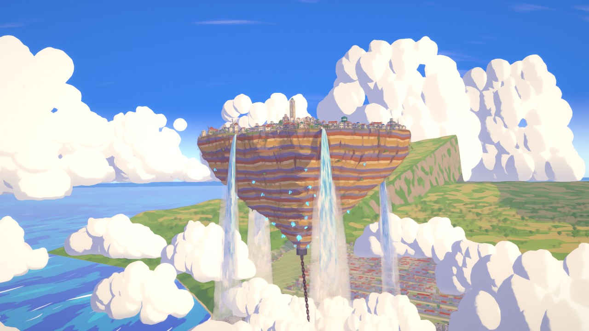
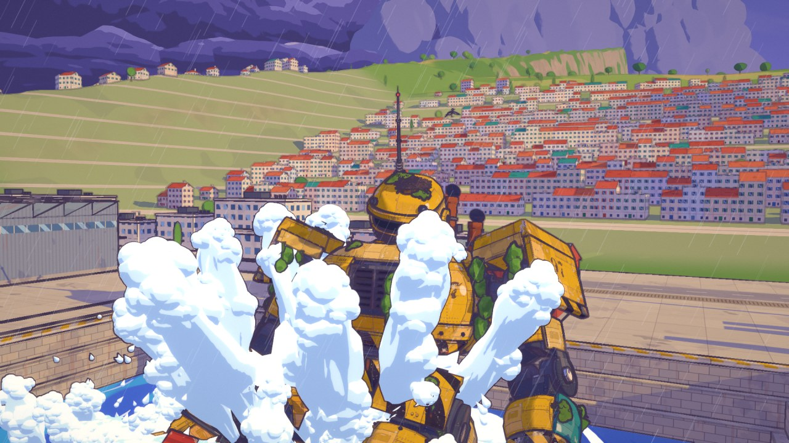
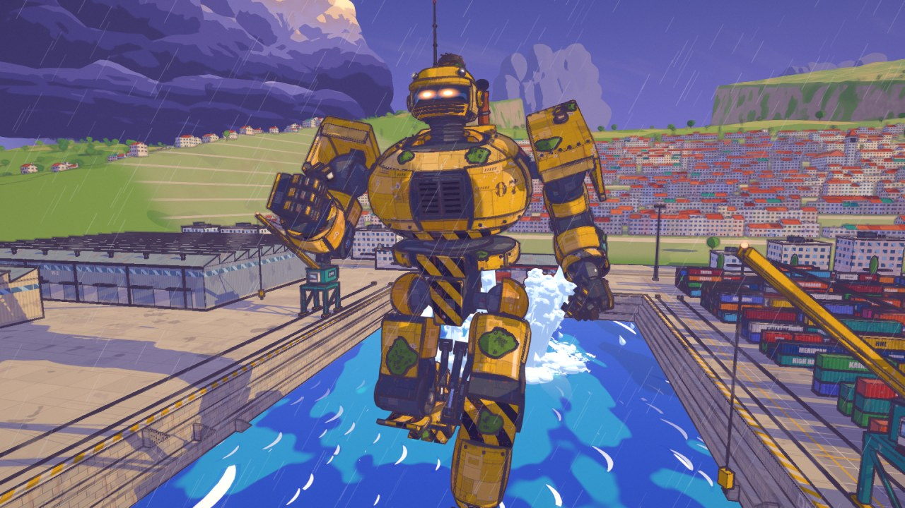
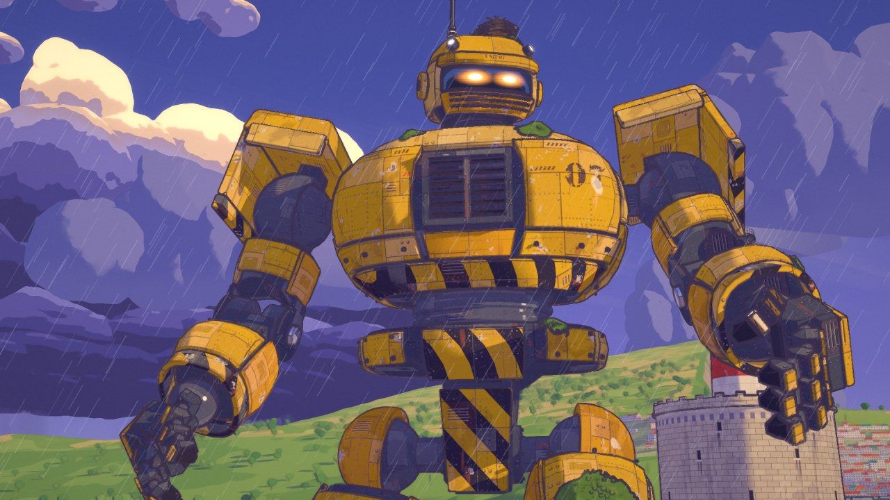
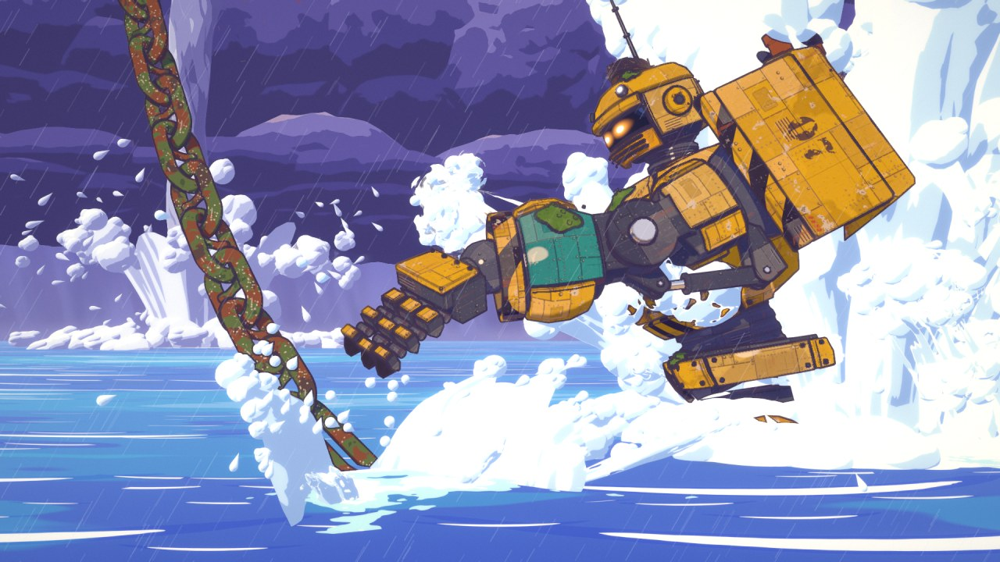
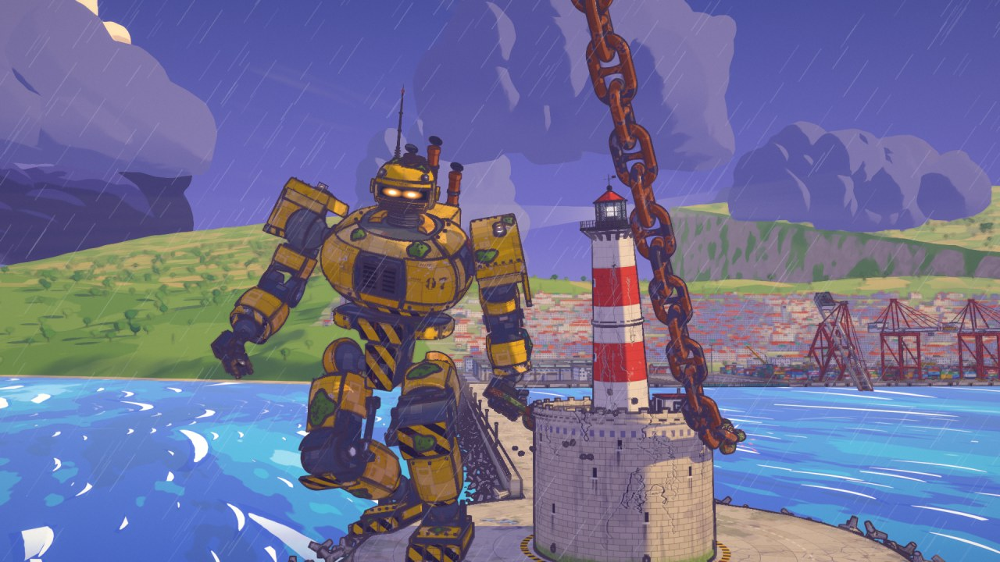
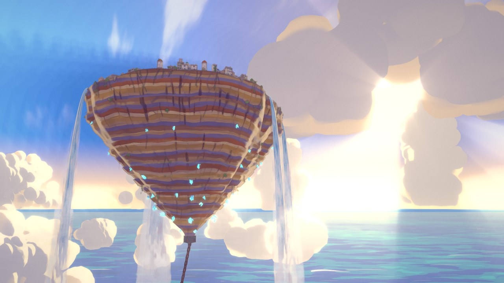
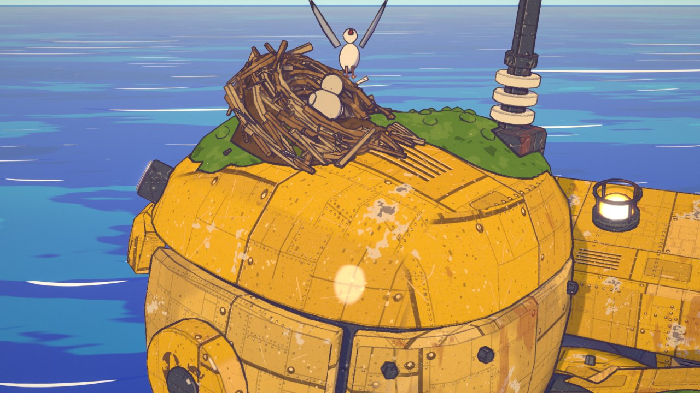

# ANCHOR · 錨

A 90-second anime short where every frame is made by code: no video model, no image model, no hand-drawn frames.
A floating island-city hangs above a harbour on one colossal chain. A storm comes in, lightning shears the anchor pin and
the city starts to drift toward a waterspout. In the dry dock below, an 80 m harbour mech that has slept for decades under
moss and a gull's nest is woken by the next bolt. It wades out, runs the breakwater, leaps, catches the last link, winds
the chain round the lighthouse and holds the city.



| | |
|---|---|
|  |  |
|  |  |
|  |  |



**Watch:** [film/anchor.mp4](film/anchor.mp4) (1920×1080, 24 fps, 92 s; click "View raw" to download).

Made with Claude Opus 5.5 in Claude Code.

---

## How it looks like anime

Blender 5.2 builds the whole world from Python and renders it in Eevee with cel light. A second pass in numpy / OpenCV
draws every frame the way a cel + painted-background production would:

| Pass | What it does |
|---|---|
| Eevee (Blender) | colour with cel light and hard lavender shadows, plus data passes: log depth, object id, material id, normals, glow, ink weight |
| paint | gouache brush on terrain, rock, distant land and clouds only |
| ink | lines from object-id, depth and normal edges, only where a material asks for ink; line pressure, thinner far away |
| cleanup | single dots of ink left by sub-pixel water are found by component and dropped; real lines are never touched, ink is never added |
| atmosphere | haze, god rays through the storm, rain |
| bloom / grade | glow on the visor, the beacon and the lightning, a high-key anime grade, vignette |

* **Everything is 3D under the drawing.** The mech is built from armour plates, rivets, pistons, moss and vines, the
  port has cranes, containers, a dry dock with a caisson gate, a town, boats, two breakwaters and a lighthouse; the city
  is a rock with houses, waterfalls and windmills; the chain is 80 real stud links.
* **Animation is on twos**, like film anime; huge things move slowly and heavily.
* **One story clock.** `shots/story.py` holds the designed paths (city, waterspout, chain end, palm) and every one of the
  43 shots reads them, so the world stays continuous across cuts. The chain (`shots/bake_chain.py`) and the mech's whole
  performance (`shots/mechanim.py`) are baked once into `out/track/` and every shot keys the same motion.
* **Checked before rendering.** `shots/qa_film.py` tests every frame of every shot on the real, evaluated meshes with BVH
  trees (mech vs the set, mech vs itself, chain vs chain, the camera never inside anything) and flags pops and teleports;
  a shot does not render until its report says PASS. Drawn water is checked too: drops flying at the lens are capped
  (`lenscull.py`), drops and billows that would sit on the armour pass behind the body (`bodydrops.py`, `bodyfx.py`,
  cut at the mech's own mattes from `tools/matte.py`).
* **Sound is fully synthesized** (`audio/score.mjs`): orchestra, storm, chain, servos and the gull, on a 150 bpm grid
  with 18 hard hits locked to the picture ([audio/cues.md](audio/cues.md)).

## How it was made

One director session and parallel agent teams in Claude Code, working from a shared production bible
([BIBLE.md](BIBLE.md)): the mech, the city, the port, the sea floor, FX, sound. Each team owned its own files and
rendered stills to check its work before the final render.

## Run it

Requirements: Blender 5.2, Python 3.11+ with `numpy`, `opencv-python` and `Pillow` (set `ANCHOR_PY` if it is not
`python`), Node 18+, and `ffmpeg` on `PATH`. Run everything from the repository root.

The baked tracks (chain, mech, grip, ground) are in `out/track/`. Check and preview shots:

```bash
blender -b -P shots/film.py -- qa all
blender -b -P shots/film.py -- stills s20-s25 16 50
```

Render the mech's mattes for the water that passes behind it, then all 2160 frames (24 samples, full size):

```bash
ANCHOR_MATTE=1 blender -b -P tools/matte.py
python tools/mattecomb.py
blender -b -P shots/film.py -- render all 24 100
```

Synthesize the score and mux the film:

```bash
node audio/score.mjs out/music.wav
ffmpeg -framerate 24 -i out/final/f%04d.png -i out/music.wav -filter_complex "[0:v]tpad=stop_mode=clone:stop_duration=2,fade=t=out:st=90.5:d=1.5,format=yuv420p[v];[1:a]afade=t=out:st=91.3:d=0.7[a]" -map "[v]" -map "[a]" -c:v libx264 -crf 16 -c:a aac -t 92 anchor.mp4
```

To re-bake the motion: `blender -b -P shots/bake_ground.py`, `blender -b -P shots/mechanim.py -- bake`,
`python shots/bake_chain.py`.

## Layout

```
BIBLE.md            the production bible: story, world map in metres, departments, look rules
kit/                look.py cel materials, env.py scene + render setup, post.py the 2D passes, qa.py BVH tests, preview.py
assets/             mech.py unit 07 and its rig, city.py, port.py, under.py the sea floor + anchor, chain.py, fx.py
shots/story.py      the story clock: city drift, waterspout, chain end, palm
shots/film.py       the film runner: 43 shots, build once, key, QA, render, post
shots/act_*.py      the shots of each act; mechanim.py mechplan.py grip.py the mech's performance
shots/qa_film.py    per-frame checks on the real geometry; lenscull.py bodydrops.py bodyfx.py drawn-water fixes
tools/              the mech's mattes and the scans behind bodyfx.json
audio/              the synthesized score and its cue sheet
tex/                generated textures (signs, panels, stencils)
out/track/          the baked chain and mech tracks
```

## License

MIT
